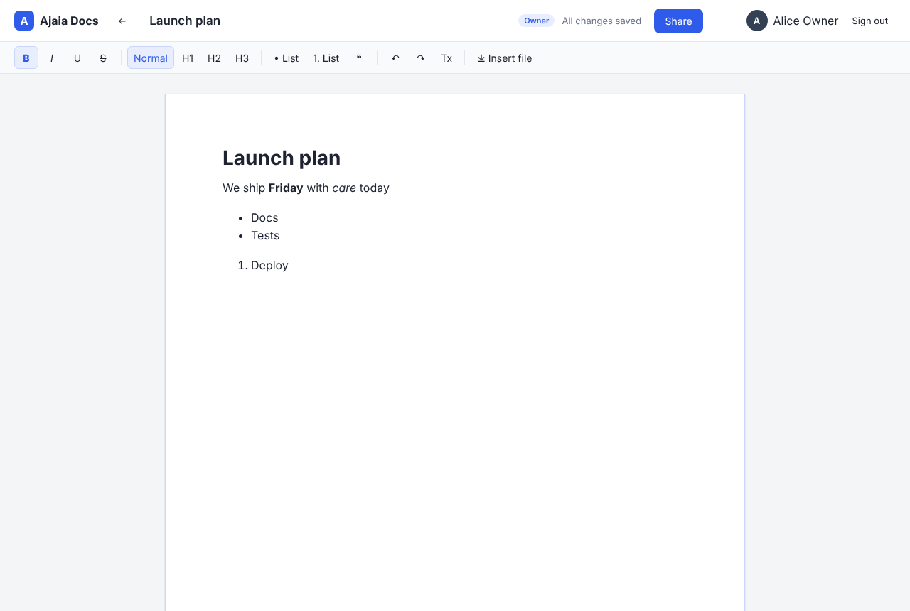

# Ajaia Docs

A lightweight collaborative document editor: create, format, import, share and reopen documents in the browser.

**Live app:** `<LIVE_URL>` · **Walkthrough video:** see `VIDEO_URL.txt`



## Demo accounts

All passwords are `demo1234`. The login screen has one-click buttons for each account.

| Account | Role in the seeded "Welcome to Ajaia Docs" document |
|---|---|
| `alice@ajaia.test` | Owner (can edit, rename, share, delete) |
| `bob@ajaia.test` | Editor (can edit and rename) |
| `carol@ajaia.test` | Viewer (read only) |

**A 2-minute sharing check:** sign in as Alice and create a document. Click **Share**, add `carol@ajaia.test` as *Can view*, then sign out. Sign in as Carol: the document shows under **Shared with me** with a *View only* badge, and it opens read-only.

## What works

| Area | Behaviour |
|---|---|
| Documents | Create, rename (title field), edit, delete (owner only), reopen. Autosaves 0.8 s after you stop typing; Ctrl/Cmd+S saves now. The status shows *Unsaved / Saving / All changes saved*. |
| Rich text | Bold, italic, underline, strikethrough, H1–H3, bulleted and numbered lists, quotes, undo/redo, clear formatting. Toolbar buttons show the current state. |
| File upload | **Import file** on the home page turns a `.txt`, `.md` or `.docx` file (max 2 MB) into a new editable document; headings, bold/italic and lists are kept. Inside a document, **Insert file** puts a file's contents at the cursor. Other file types are rejected with a clear message. |
| Sharing | The owner shares by email as *Can edit* or *Can view*, can change the role, and can revoke access. Home shows **My documents** and **Shared with me** separately, with role badges. |
| Access control | Enforced on the server for every endpoint. Documents you can't access return 404, so their existence isn't revealed. |
| Persistence | SQLite. Documents, formatting (as sanitized HTML) and shares survive refresh and restart. |
| Concurrent edits | Each save carries the version it was based on. A stale save gets **409**, and the UI offers *Load their version* or *Keep mine*, so nobody's work is silently overwritten. |
| Security basics | An allowlist HTML sanitizer runs on every write (blocks stored XSS). Passwords are hashed, cookies are HttpOnly + SameSite, and request sizes are capped. |

## Run locally

Requires Python 3.11+.

```bash
python -m venv .venv && source .venv/bin/activate   # Windows: .venv\Scripts\activate
pip install -r requirements-dev.txt
python wsgi.py                                      # http://127.0.0.1:5000
```

The database is created at `data/ajaia_docs.db` and seeded with the demo accounts on first run. To reset, delete the `data/` folder.

| Env var | Default | Purpose |
|---|---|---|
| `DATABASE_PATH` | `data/ajaia_docs.db` | SQLite file location |
| `SECRET_KEY` | random per process | Session signing. **Set it in production**, or users are signed out on restart. |
| `SESSION_COOKIE_SECURE` | `0` | Set to `1` behind HTTPS |
| `SEED_DEMO_DATA` | `1` | Seed demo users and the welcome doc into an empty DB |
| `PORT` | `5000` | Dev server port |

## Tests

```bash
pytest -q          # 15 API/unit tests, ~3 s
```

They cover auth, create/rename/edit/reopen-after-restart, validation, XSS sanitizing, owned vs shared lists, the share → edit → view-only → revoke lifecycle, edit conflicts, and `.txt`/`.md`/`.docx` import including bad files. CI runs them on every push (`.github/workflows/test.yml`).

There is also a browser smoke test (Playwright). It drives the real UI through every flow above and produces the screenshots in `docs/screenshots/`:

```bash
npm i -D playwright && npx playwright install chromium
DATABASE_PATH=/tmp/e2e.db PORT=5055 python wsgi.py &
node tests/e2e/browser-smoke.js
```

## Deploy

**Render (free, what the live URL uses):** push the repo to GitHub, then in Render choose *New → Blueprint* and pick the repo. `render.yaml` sets the build, the start command (`gunicorn wsgi:app --workers 1 --threads 4`), the health check and a generated `SECRET_KEY`.

> Render's free tier has an ephemeral disk and sleeps when idle. Documents last while the instance is up, but a redeploy or cold start resets the database to the seed data. The first request after idling takes ~30 s. For durable hosting, attach a persistent disk (paid) or point `DATABASE_PATH` at a mounted volume. See ARCHITECTURE.md.

**Docker (anywhere):** `docker build -t ajaia-docs . && docker run -p 8000:8000 -v $PWD/data:/app/data ajaia-docs`

## Project layout

```
app/
  __init__.py     app factory, config, error handlers
  api.py          JSON API: auth, documents, import, sharing
  access.py       role rules (owner > editor > viewer)
  db.py           SQLite schema + demo seed
  sanitize.py     allowlist HTML sanitizer
  importers.py    .txt / .md / .docx -> sanitized HTML
static/           index.html, app.js (vanilla JS SPA), styles.css
tests/            pytest suite + e2e/browser-smoke.js
sample-files/     example .md / .txt / .docx to try the import
docs/screenshots/ UI screenshots from the browser test
```

## API summary

| Method & path | Who | Notes |
|---|---|---|
| `POST /api/auth/login`, `POST /api/auth/logout`, `GET /api/auth/me` | anyone | session cookie |
| `GET /api/documents` | signed in | `{owned: [...], shared: [...]}` |
| `POST /api/documents` | signed in | `{title?, content?}` |
| `GET /api/documents/:id` | viewer+ | owners also get `shares` |
| `PATCH /api/documents/:id` | editor+ | `{title?, content?, version}`, returns 409 on a stale version |
| `DELETE /api/documents/:id` | owner | |
| `POST /api/documents/import` | signed in | multipart `file` → new document |
| `POST /api/documents/:id/import` | editor+ | multipart `file` → `{html}` to insert |
| `GET/PUT /api/documents/:id/shares`, `DELETE .../shares/:userId` | owner | `PUT {email, role}` grants or changes access |

Errors are always `{"error": "message"}` with a meaningful status code.

## Known limitations

See ARCHITECTURE.md → *What I cut*. In short: no real-time co-editing (conflicts are detected rather than merged), paste is plain text, there's no sign-up, and free-tier hosting resets data on redeploy.
